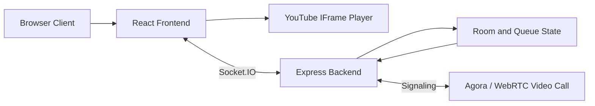

# SyncSound

Listen together. Create a room, share the link, and every track plays in sync for everyone in it. Two people in the same room can also start a private video call while the music keeps playing.

## Table of Contents

- [Project Overview](#project-overview)
- [Features](#features)
- [Technology Stack](#technology-stack)
- [Architecture](#architecture)
- [Project Structure](#project-structure)
- [Installation and Setup](#installation-and-setup)
- [Environment Variables](#environment-variables)
- [Usage Guide](#usage-guide)
- [Synchronization and Technical Details](#synchronization-and-technical-details)
- [Testing and Quality Checks](#testing-and-quality-checks)
- [Screenshots and Demo](#screenshots-and-demo)
- [Troubleshooting](#troubleshooting)
- [Future Improvements](#future-improvements)
- [Contribution and License](#contribution-and-license)

## Project Overview

SyncSound is a real-time synchronized music-listening web application. It lets people create or join a listening room, listen to the same YouTube video in synchronization, chat live, manage a shared queue, and start a private video call.

The problem it solves is simple: listening to music together remotely is usually out of sync. SyncSound keeps one authoritative playback timeline on the server so every participant hears the same track at the same position, while late joiners and reconnecting clients catch up automatically.

The focus is a simple, shared listening experience: one room, one queue, one timeline.

## Features

Completed:

- Create and join listening rooms with case-insensitive room codes.
- Host and listener roles; member list with name, role, and client id.
- YouTube IFrame Player integration in the stage; player created once per container.
- Synchronized play, pause, seek, and track changes driven by the server.
- Authoritative playback state with revision handling and drift correction.
- Shared song queue with add, remove, and reorder.
- YouTube song search and metadata retrieval through the backend.
- Real-time chat using Socket.IO, server-owned and room-isolated.
- Chat history delivered on join and reconnect.
- Reply-capable message identifiers (server-assigned ids).
- Song notes and dedications via `DedicationCard`.
- Live emoji reactions with floating animations and rate limiting.
- Agora-powered WebRTC video calls (two participants per room).
- Reconnection and late-join synchronization.
- Music player controls, mini player, queue panel, search, and library views.
- Responsive layout with breakpoints and reduced-motion support.

Planned or partial:

- Persistent listening history (library is device-local only).
- Shared favorites and playlists (playlists not implemented).

## Technology Stack

Frontend:

- React 19 + TypeScript
- Vite 8
- socket.io-client 4.8
- agora-rtc-sdk-ng 4.24
- lucide-react

Backend (`backend/`):

- Node.js (CommonJS)
- Express 4.19
- Socket.IO 4.7
- agora-token

Styling:

- Plain CSS with design tokens in `src/index.css` and `src/App.css`

Testing:

- Node-based integration tests (`tests/*.js`, `tests/*.cjs`)
- Render test using Vite SSR + jsdom
- oxlint for linting
- TypeScript (`tsc -b`) for type checking

## Architecture



Playback events (play, pause, seek, track change, track end) are sent as explicit commands to the backend. The backend updates the authoritative room state and broadcasts it to all participants in the room. Late joiners and reconnecting clients receive the current position, queue, members, and chat history.

## Project Structure

```
src/
  components/   UI components (chat, common, layout, player, queue)
  features/call/ WebRTC call logic and floating window
  hooks/         useRoom, useSocket, useYouTubePlayer, useLibrary, useMediaQuery
  pages/         CreateRoom, JoinRoom, SearchView, LibraryView
  types/         Shared TypeScript types
  utils/         Helpers (avatar, clientId, displayName, youtubeMeta, etc.)
backend/
  server.js     HTTP + Socket.IO entry point
  roomState.js  Authoritative room/playback state
  callSignaling.js  Call signaling relay
  youtubeSearch.js YouTube Data API proxy
  agoraToken.js Agora token endpoint
tests/          Integration and render tests
```

## Installation and Setup

Prerequisites: Node.js (LTS), npm.

```bash
git clone <repo-url>
cd SyncSound
npm install
cd backend && npm install && cd ..
```

Start backend:

```bash
node backend/server.js
```

Start frontend:

```bash
npm run dev
```

Open `http://localhost:5173`. Backend runs on `http://localhost:4000`.

To test two clients: open two browser windows/tabs (or an incognito window) and join the same room code.

## Environment Variables

Frontend (`.env` or `.env.local`):

| Variable | Required | Purpose |
| --- | --- | --- |
| `VITE_SOCKET_URL` | optional | Backend URL; defaults to `http://localhost:4000` |
| `VITE_API_URL` | optional | REST API URL; defaults to socket server |
| `VITE_ICE_SERVERS` | optional | JSON array of ICE servers |
| `VITE_TURN_URL` | optional | Single TURN server URL |
| `VITE_TURN_USERNAME` | optional | TURN username |
| `VITE_TURN_CREDENTIAL` | optional | TURN credential |

Backend (process env):

| Variable | Required | Purpose |
| --- | --- | --- |
| `PORT` | optional | Backend port; defaults to `4000` |
| `ROOM_TTL_MS` | optional | Empty room lifetime; defaults to 5 minutes |
| `SYNC_DEBUG` | optional | `1` enables sync diagnostics |
| `YOUTUBE_API_KEY` | optional | YouTube Data API v3 key (search disabled without it) |
| `YOUTUBE_SEARCH_CACHE_MS` | optional | Search cache TTL; `0` disables |
| `YOUTUBE_API_BASE_URL` | optional | YouTube API base (tests only) |

Copy `.env.example` to `.env` and fill in values. Never commit real credentials.

## Usage Guide

1. Launch SyncSound (backend then frontend).
2. Create a listening room (or join with a room code).
3. Invite another participant using the room code or invite link.
4. Add a YouTube song via search or pasted link.
5. Play, pause, and seek together.
6. Add songs to the shared queue.
7. Chat and reply to messages.
8. Attach a dedication to a song.
9. Send live song reactions.
10. Start a video call (requires HTTPS outside localhost and TURN for strict NATs).

## Synchronization and Technical Details

- Authoritative room playback state lives in `backend/roomState.js`.
- Playback commands are explicit; the server broadcasts authoritative state with revision handling.
- Drift correction is applied on the client via `useYouTubePlayer`.
- Late joiners and reconnecting clients receive current position, queue, members, and chat history.
- Track-end handling advances the queue exactly once; stale/duplicate end events are rejected.
- Socket.IO rooms isolate events per room.
- Reactions are rate-limited and expire with floating animations.
- Dedications and reply metadata are attached to chat/queue items as implemented.

## Testing and Quality Checks

Start the backend first, then run tests:

```bash
node backend/server.js
npm test
```

Individual commands:

```bash
npm run test:room
npm run test:chat
npm run test:queue
npm run test:display-name
npm run test:ice-config
npm run test:search
npm run test:render
npm run lint
npm run build
npm run preview
```

Backend scripts:

```bash
npm --prefix backend start
npm --prefix backend run dev
```

Tests cover room lifecycle, chat rules and isolation, queue commands, display names, ICE config, YouTube search (backend + client), and a full render test of the UI.

## Screenshots and Demo

Screenshots are not included. Suggested placeholders:

- `docs/screenshots/lobby.png`
- `docs/screenshots/room.png`
- `docs/screenshots/queue.png`
- `docs/screenshots/chat.png`
- `docs/screenshots/call.png`

## Troubleshooting

- YouTube videos that cannot be embedded: search filters to embeddable videos; some videos are blocked by their owner.
- Browser extensions blocking YouTube requests: disable ad blockers/privacy extensions for localhost.
- Backend connection failures: verify `VITE_SOCKET_URL` and that backend is running.
- Incorrect environment variables: check `.env` and restart both processes.
- Room joining/reconnect issues: ensure same room code; reconnect re-joins automatically.
- Video-call permissions: requires HTTPS outside localhost; allow camera/mic.
- Localhost/network: use `http://localhost:5173`; ensure ports 5173 and 4000 are free.

## Future Improvements

- Persistent listening history.
- Shared favorites and playlists.
- Better mobile optimization.
- Additional accessibility improvements.

## Contribution and License

Contributions are welcome. Open an issue or pull request with a clear description. Run `npm run lint`, `npm run build`, and `npm test` before submitting.

No license file is present in the repository; do not assume an open-source license. Add a `LICENSE` file if you intend to distribute.

## Missing Configuration Details

- Agora App ID/token endpoint configuration could not be fully verified; inspect `backend/agoraToken.js` for exact requirements.
- No deployment URL or hosting configuration is documented.
- No CI configuration is present.
